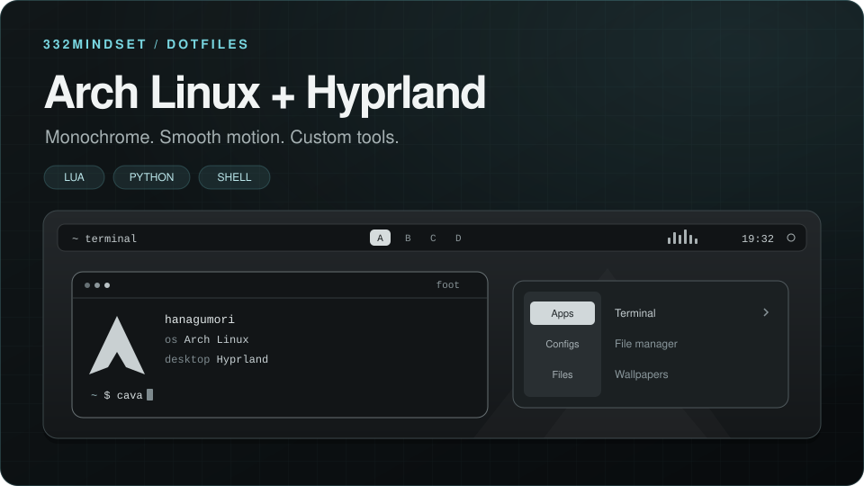

<div align="center">



<br/>

[](https://t.me/hanaagumori)
[](https://www.youtube.com/@hanagumorii)
[](https://portfolio-gilt-three-30.vercel.app)
[](mailto:neovimvictorovich@tutamail.com)

</div>

<br/>

## currently

<table>
<tr>
<td width="55%">
<a href="https://www.youtube.com/watch?v=beIpVuMDd-8"></a>
</td>
<td valign="top">

### [mainArchLinuxDotfiles](https://github.com/332mindset/mainArchLinuxDotfiles)

my monochrome arch + hyprland desktop, with an installer that backs up your old configs before touching anything.

<sub>next: automatic package install and an interactive menu</sub>

```sh
python3 install.py --apply
```

[repo](https://github.com/332mindset/mainArchLinuxDotfiles) · [showcase](https://www.youtube.com/watch?v=beIpVuMDd-8)

</td>
</tr>
</table>

<br/>

## activity

<div align="center">


</div>

<br/>

## stack

<p align="center">
  
</p>