<div align="center">



<br/>

## [mainArchLinuxDotfiles](https://github.com/332mindset/mainArchLinuxDotfiles)

my monochrome glass arch + hyprland desktop — smooth animations, one style everywhere

<br/>

[](https://github.com/332mindset/mainArchLinuxDotfiles)
[](https://www.youtube.com/watch?v=beIpVuMDd-8)
[](https://github.com/332mindset/mainArchLinuxDotfiles/stargazers)

<br/><br/>

<a href="https://github.com/332mindset/mainArchLinuxDotfiles"></a>

</div>

<br/>

<table>
<tr>
<td width="50%" valign="top">

**hyprland** — lua config, animations, window rules<br/>
**waybar** — minimal frosted-glass bar<br/>
**rofi** — launcher, clipboard, wallpapers, power menu

</td>
<td width="50%" valign="top">

**kitty + zsh** — fastfetch with a random pokémon<br/>
**hyprlock** — glass lock screen with now playing<br/>
**swaync · cava · dolphin · gtk** — all in one style

</td>
</tr>
</table>

**install** — old configs are backed up before anything is replaced

```sh
git clone https://github.com/332mindset/mainArchLinuxDotfiles
cd mainArchLinuxDotfiles
python3 install.py           # preview what will change
python3 install.py --apply   # install
```

<div align="center">
<sub>⭐ if you like the rice, a star on the repo helps a lot</sub>
</div>

<br/>

## stack

<table align="center">
<tr>
<td align="center" width="50%"><sub><b>SYSTEM</b></sub><br/><br/></td>
<td align="center" width="50%"><sub><b>LANGUAGES</b></sub><br/><br/></td>
</tr>
<tr>
<td align="center"><sub><b>FRONTEND</b></sub><br/><br/></td>
<td align="center"><sub><b>SHIP</b></sub><br/><br/></td>
</tr>
</table>

<br/>

## activity

<div align="center">




<br/><br/>


</div>

<br/>

<div align="center">

[](https://t.me/hanaagumori)
[](https://www.youtube.com/@hanagumorii)
[](https://portfolio-gilt-three-30.vercel.app)
[](mailto:neovimvictorovich@tutamail.com)

</div>
